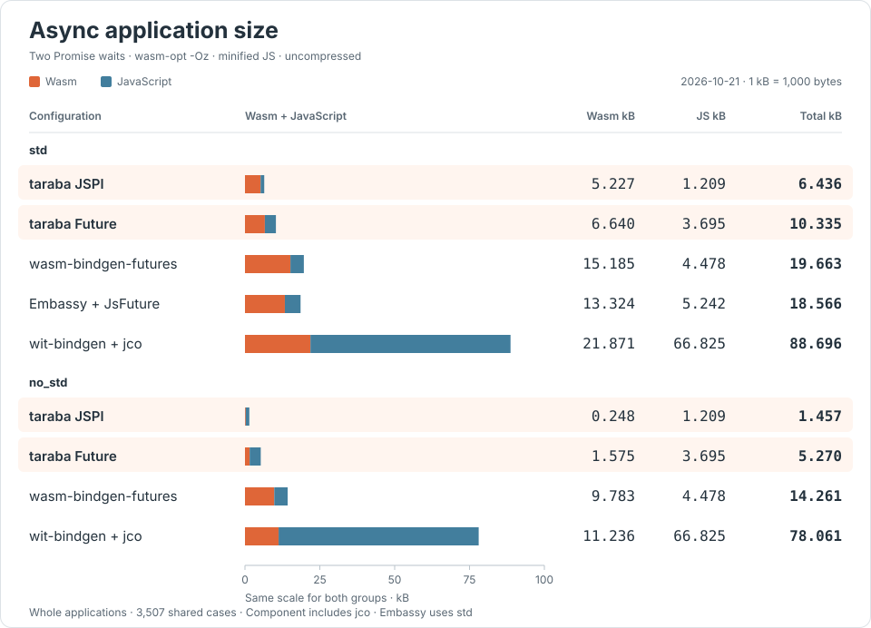

# taraba

[English](README.md) | 日本語

**WebAssembly のランタイムサイズに最適化した、Rust 向けの async runtime と allocator。**

<p align="center">
  
</p>

Rust でフロントエンドのミドルウェアを書くために、Wasm と JavaScript の配布サイズを小さくします。専用の `taraba-allocator` と最新の Wasm 仕様を使い、非同期処理は JavaScript の Promise とイベントループに委ねます。std / no_std に対応します。

正規表現や文字列処理を JS の標準機能に委ねる [`taraba-helpers`](docs/helpers.ja.md) も用意しています。

## 最小サンプル

Rust の `async` / `.await` で JavaScript の非同期関数を呼び、型付きの npm パッケージとして公開できます。Promise の待機中も JS のイベントループは動き続けます。

以下の型付き Core async API は未リリースです。Rust 1.85 以上で CLI と対応する Rust runtime を同じ checkout から使い、リポジトリ外でプロジェクトを作成します。ビルドには Binaryen 133 のツールを PATH に配置してください。[インストールと Cargo の依存設定](docs/guide.ja.md#インストール)。

```sh
cargo install --path /path/to/taraba/crates/taraba-cli --locked --force
rustup target add wasm32-unknown-unknown

taraba new hello --future
cd hello
```

`wit/app.wit` で、JS から受け取る関数と公開する関数を定義します。戻り値の `future<s32>` が Promise の結果の型を表します。

```wit
package taraba:app@0.1.0;
world app {
    import add: func(a: s32, b: s32) -> future<s32>;
    export run: func(a: s32, b: s32) -> future<s32>;
}
```

雛形の `build.rs` が WIT から `Guest` と import 関数を生成します。`src/lib.rs` でそれを実装します。allocator と panic handler は雛形の設定を使います。

```rust
include!(concat!(env!("OUT_DIR"), "/bindings.rs"));
bindings!();

struct App;
impl Guest for App {
    async fn run(a: i32, b: i32) -> HostResult<i32> {
        let first = add(a, b).await?;
        add(first, 1).await
    }
}
export!(App);
```

`HostResult` は host の Promise 拒否を Rust のエラーとして伝えます。`run` の結果は JS では `Promise<number>` です。`taraba build` が bindings の再生成、Cargo の release / wasm32-unknown-unknown ビルド、最適化・JS・TS 型定義の生成まで実行します。既定は `Cargo.toml`・`wit/`・出力先 `pkg/` です。

```sh
taraba build
```

生成物は、そのまま npm パッケージとして配布できる `pkg/` に出力されます。

```text
pkg/
├── index.js          # createHost を公開する ESM エントリー
├── index.d.ts        # WIT から生成する型定義
├── app.wasm
├── runtime.mjs
├── runtime.d.mts
├── package.json
└── wit/
```

package.json の名前・バージョン・ライセンスは、選んだ Cargo package の `name`・`version`・`license` を引き継ぎます。ライセンス未指定なら `UNLICENSED` です。`--npm-name @scope/library`、`--npm-version`、`--license` で個別に上書きできます。

`pkg/` で `pnpm pack` すれば配布用 tarball を作れます。npm へ公開する場合も `pkg/` で `pnpm publish --access public` を実行します。`taraba build` 自体は公開しません。[配布の詳細](docs/guide.ja.md#生成する-npm-パッケージ)。

次を `main.mjs` に保存し、Node.js 24+ の `node main.mjs` で呼び出せます。

```js
import { readFile } from "node:fs/promises";
import { setTimeout as delay } from "node:timers/promises";
import { createHost } from "./pkg/index.js";

const host = createHost({
  bindings: {
    add: async (a, b) => {
      await delay(1);
      return (a + b) | 0;
    },
  },
});
const { instance } = await WebAssembly.instantiate(
  await readFile(new URL("./pkg/app.wasm", import.meta.url)),
  host.imports,
);
host.attach(instance.exports);
console.log(await host.run(20, 21)); // 42
```

`taraba build` は WIT から `AppBindings` と `AppHost` を生成します。TypeScript と JS のエディターで `bindings` の引数・戻り値と `host.run(...)` を推論し、存在しないメソッドや誤った引数を型エラーにします。npm 出力も同じ API です。

Wasm の読み込みと生成は標準の `WebAssembly.instantiate` が担当します。taraba は import と安全な呼び出しを提供します。`host` ごとに一つの instance を接続し、export は `host.run(a, b)` のように直接呼びます。

開発中は `taraba build --watch` で Rust・WIT・ローカル依存を監視し、Cargo のコンパイルから成果物の生成まで自動実行できます。

CLI の更新後は `taraba update --check` で埋め込みアセットの差分を確認し、
`taraba update` で前回の条件を使って Wasm・JS・TS を再生成できます。
更新に失敗した場合は既存の出力を保持します。[アセットの更新手順](docs/guide.ja.md#生成アセットの更新)。

## どれくらい小さいか

<!-- async-size:begin -->
同じ二段の Promise 待機・加算を行う共通の Rust 実装で比較しています。各構成は同じ3,507ケースを通過。taraba-allocator（size classes 無効）を共通で使い、wasm-opt -Oz と JS minify を適用した非圧縮サイズです。1 kB = 1,000 bytes。



<details>
<summary>数値を表で見る</summary>

| 構成 | Rust | Wasm kB | JS kB | 合計 kB |
|---|---|---:|---:|---:|
| taraba JSPI | std | 5.227 | 1.209 | **6.436** |
| taraba JSPI | no_std | 0.248 | 1.209 | **1.457** |
| taraba Future | std | 6.640 | 3.695 | **10.335** |
| taraba Future | no_std | 1.575 | 3.695 | **5.270** |
| wasm-bindgen-futures | std | 15.185 | 4.478 | **19.663** |
| wasm-bindgen-futures | no_std | 9.783 | 4.478 | **14.261** |
| Embassy WASM + JsFuture | std | 13.324 | 5.242 | **18.566** |
| wit-bindgen async + jco | std | 21.871 | 66.825 | **88.696** |
| wit-bindgen async + jco | no_std | 11.236 | 66.825 | **78.061** |

</details>

taraba の JSPI はエンジンによる Promise 待機、Future は Rust の `async` / `.await` を使う構成です。`taraba build` が生成 Wasm から自動選択します。上のサンプルは Future 構成です。std が既定で、no_std の雛形は `taraba new hello --future --no-std` で作れます。

wit-bindgen async は WIT の `async func` から Rust の `async fn` / Future を生成する標準 Component 構成です。不要な `async-spawn` は無効にし、JS 側で実行するための jco の接続コードも計上しています。

Embassy は公式の WASM event-loop integration と wasm-bindgen-futures の JsFuture を使用します。この構成は std をリンクするため、no_std の値は載せていません。表はアプリ全体のサイズです。JSPI は instance を直列実行し、各 executor の並行実行・エラー・タスク容量の契約は異なります。[全ランタイムの測定結果・圧縮・wee_alloc 対照・測定条件](docs/async-size.ja.md)。
<!-- async-size:end -->

Record・文字列・バイト列・Result を扱う[複合型の比較](docs/rich-async-size.ja.md)も計測しています。同じ Rust 処理・共通テストで、wit-bindgen の標準 async ABI と配布サイズ・実行時間・メモリを比較します。

ビルド時に `format!` / `write!` などのサイズ警告を出します。`taraba build --insight` の後、`taraba insight --paths fmt` で最適化後の大きな関数と保持経路を調べられます。[解析の使い方](docs/insight.ja.md)。

## JS の標準機能を必要な分だけ使う

`taraba-helpers` は、正規表現や Unicode の実装を Wasm に持ち込まず、JS エンジンの標準機能を使うためのオプションです。crates.io の依存として追加します（Rust 1.85 以上）。

```toml
[dependencies]
taraba-helpers = { version = "0.1.0", features = ["strings"] }
```

```rust
use taraba_helpers::string::JsString;

fn utf16_units(input: &str) -> u32 {
    JsString::from(input).utf16_len()
}
```

通常通り `taraba build` するだけで接続されます。Cargo feature は Rust API を有効にする指定です。ビルドは wasm-opt 後の import を調べ、文字列・Iterator・Segmenter・Decoder の使う関数だけを生成します。ヘルパーが未使用なら追加 JS は **0 B** です。

| 処理                 | feature     | 生成する処理の範囲                                                                |
| -------------------- | ----------- | --------------------------------------------------------------------------------- |
| 文字列長を読む       | `strings`   | UTF-8 入力・UTF-16 長・ハンドル解放。正規化・大小文字変換・TextEncoder は含めない |
| 正規化する           | `strings`   | 入力・正規化。UTF-8 出力は `write_utf8` 等を使った時だけ                          |
| 分割件数を数える     | `segmenter` | 入力・分割・Iterator。要素の文字列・位置・word-like の取得は含めない              |
| 文字コードを変換する | `encoding`  | 指定した文字コードの Decoder と、使う文字列操作                                   |

使用時には共通ハンドル基盤も入ります。これは最初の文字列機能を使う時の共通費で、各 API の費用として足し合わせるものではありません。`std` / `no_std`、Core JSPI / Future に対応します。公開 WIT と `host.method(...)` の使い方は同じで、手動の JS bindings は不要です。

[文字列・Iterator の使い方とサイズ表](docs/strings.ja.md)では Wasm、生成 JS、Rolldown 出力を分けて記録しています。Component / JS のない WASI host 向けのヘルパーではありません。

## Why

Rust/Wasm で使われてきた [`wee_alloc`](https://github.com/rustwasm/wee_alloc) と [`console_error_panic_hook`](https://github.com/rustwasm/console_error_panic_hook) は、2025年8月にアーカイブされました。これを機に、最新の Wasm 仕様と JS のイベントループを前提とした小さな async runtime・allocator・panic レポートを自作したのが taraba です。allocator は wee_alloc をベースに改修し、リリース時のエラーは短いコードに、詳しい診断はデバッグビルドに分けています。

フロントエンドのライブラリは、別のライブラリに組み込まれ、依存グラフの深い場所で使われます。そこで数十 kB のランタイムが増えると、小さな処理のためには採用しづらくなります。アプリ本体が許容できるオーバーヘッドでも、再利用されるミドルウェアでは選択肢から外れる理由になります。

サイズ感の参考として、Rolldown で測った小さな利用例は Valibot 約2.9 kB、Preact 約10.6 kB、Hono 約18.2 kB（非圧縮・minify）です。Rust で書く処理も、この規模で依存に加えられることを目指しています。[React・Zod を含む全結果と測定条件](docs/frontend-size.md)。

**JS ランタイムは複数の taraba ライブラリで共有できます。** 同じ profile のランタイムを共通 ESM チャンクへ集約し、同じ URL から読み込めば、一度のロード・評価で使い回せます。既定のパッケージ別コピーには、[Rolldown による集約](docs/esm-cache.ja.md)が必要です。比較表はアプリ用 wrapper を含む値で、[共有ランタイム単体のサイズ](docs/esm-cache.ja.md#実測と再現)は別に計測しています。各アプリの wrapper・Wasm と instance の状態は個別です。

共有ランタイムは `createHost` だけを公開し、`index.js` は型付きのアプリメソッドを生成します。Wasm の生成・ロードには標準の WebAssembly API を使います。

**JS に通信・タイマーなどの I/O を任せ、Rust が計算・検証・変換を担うなら、まず no_std で始められます。** no_std でも [`alloc`](https://doc.rust-lang.org/stable/alloc/) と allocator により `Vec`・`String`・`Box` を使え、Future 構成も利用できます。std を要求する依存がなければ、ミドルウェアのロジックのために std を同梱する必要はありません。二段加算の計測用 fixture は no_std + JSPI で Wasm 248 Bとなり、共通 JS を一度配信した後の追加分を小さくできます。実際のロジックや依存、allocator を使用すれば、そのコードも加わります。

Core/JSPI の境界は数値（s32/u32/f64）です。Core Future は文字列・record・list などの [WIT の値型](docs/core-runtime.ja.md#型と必要な変換処理)を async の引数・結果にも使えます。使う変換処理だけを生成し、共有ランタイムは増えません。 [TS との疎通：名前付き型・readonly・TypedArray](docs/typescript.ja.md)。標準 Canonical ABI の相互運用には Component を選びます。

`taraba-allocator` は単独でも使える、wee_alloc 由来の軽量 allocator です。サイズ優先と、小さな確保の性能を重視する構成を選べます。[allocator の構成と比較](docs/guide.ja.md#allocator-の構成を選ぶ)。

## ドキュメント

- [現在の対応状況と制限](docs/status.ja.md): 対応型・非同期と終了処理・配布・未対応機能・検証範囲。
- [利用ガイド](docs/guide.ja.md): インストール、WIT/Rust async、ドメインモデル例、Node/browser のロード、TS、npm、編集から配布までの手順。
- [Core API リファレンス](docs/core-runtime.ja.md): JSPI/Future の契約、所有権、task 上限とエラー。
- [エラーコード](docs/error-codes.md): ランタイムエラーの原因と対処。
- [JS ランタイムの共有](docs/esm-cache.ja.md): 複数の Core ライブラリを共通 ESM チャンクに集約し、instance の状態を分離する検証。
- [現在の非同期サイズ比較](docs/async-size.ja.md): taraba・wit-bindgen・wasm-bindgen-futures・Embassy などの同等処理。同期→async 増分と必要な全 JS/Wasm を計上。
- [ドキュメント一覧](docs/README.ja.md): 過去の測定と未採用の実験。
- [開発・検証手順](docs/development.ja.md): テスト、パッケージ検証、測定の再実行。

JavaScript の async は Safari 27+ / JSPI 対応 V8 を前提とします。Safari 実機と native Component host の実行はここでは未検証です。[実行契約と制限](docs/core-runtime.ja.md)。

CLI/runtime/JS は MIT、任意で使う allocator は MPL-2.0。[来歴とライセンス](THIRD_PARTY.md)。

生成 npm には MIT/MPL の通知と、allocator の版を指定したソース取得先を同梱します。
アプリ自身のライセンスは別です。別版・改変版の MPL 対象依存を使う場合は通知を更新してください。
[ライセンスと来歴](https://github.com/mizchi/taraba/blob/main/THIRD_PARTY.md)を参照してください。
